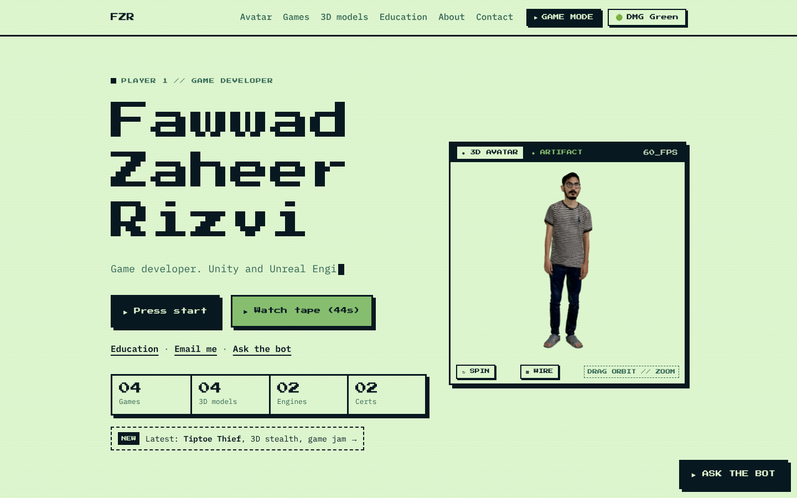
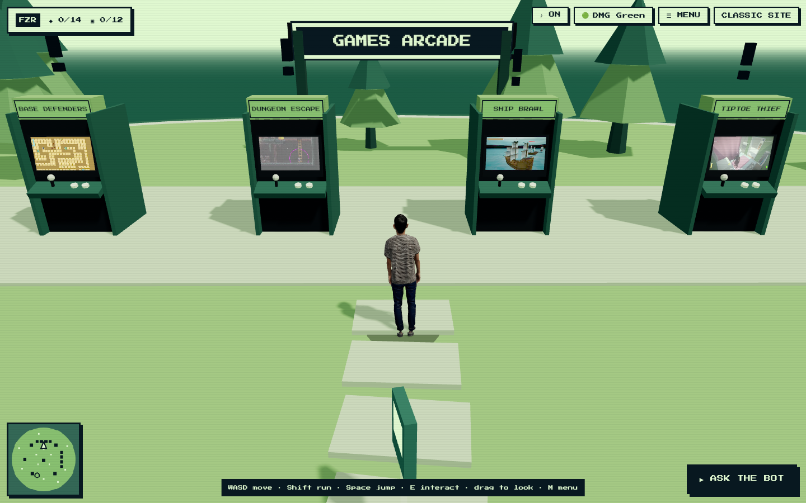

# Fawwad Zaheer Rizvi: Interactive 3D Web Portfolio

Semester project: a retro, Game Boy-styled portfolio you can **play**. It opens as a small 3D island where my own avatar walks between an arcade of my games, a gallery of my Blender models, an academy, a mailbox and a chatbot robot. A classic scrolling version of the same content is one click away.

- **Live site:** https://portfolio-website-alpha-neon-97.vercel.app/
- **Report:** [`docs/report/Fawwad_Portfolio_Report.pdf`](docs/report/Fawwad_Portfolio_Report.pdf) (Word version: [`.docx`](docs/report/Fawwad_Portfolio_Report.docx))
- **Screenshots:** [`docs/screenshots/`](docs/screenshots/)




## Features

| Module | What's in it | Where |
|---|---|---|
| 1. 3D portfolio | Explorable 3D island (React Three Fiber) plus a responsive classic site: home, about and skills, games, 3D models, education, contact | `src/game/`, `src/components/` |
| 2. 3D avatar | My avatar as the player character and in the hero viewer (orbit, zoom, wireframe, turntable) | `public/models/avatar.glb`, `public/models/avatar.blend` |
| 3. Promo video | 44 s After Effects promo, embedded in the site and on the island's TV | `after-effects/`, `public/video/promo.mp4`, `tools/promo/ae/` |
| 4. RAG chatbot | Answers only from `data/*.md`, streams replies, cites the page section it used | `rag/`, `backend/src/routes/chat.js`, `src/components/Chatbot.jsx` |
| 5. Contact system | Form validated in the browser and on the server (Zod), honeypot, timing check, rate limit, email via Gmail SMTP or Resend | `src/components/Contact.jsx`, `backend/src/routes/contact.js` |
| 6. Deployment + docs | Vercel (site + API as a serverless function), this README, the PDF report | `vercel.json`, `api/index.js`, `docs/` |

**Extra credit:** three colour palettes, including a dark one (CRT Night); mouse-reactive 3D; chatbot answers that link to page sections; project search and filters; accessibility (ARIA, keyboard play, reduced motion, Lighthouse accessibility 100); game audio and music; collectibles; a timed sky obby with checkpoints and a prize.

## Tech stack

- **Frontend:** React 18, Vite 5, three.js, @react-three/fiber, @react-three/drei, hand-written CSS
- **Backend:** Node.js 20+, Express, Zod, helmet, express-rate-limit, Nodemailer
- **RAG:** Google Gemini (`gemini-embedding-001`, 768 dims) for embeddings and chat, JSON vector index with in-memory cosine search
- **3D / video:** Blender (avatar and models, Draco-compressed GLB), Adobe After Effects (promo)
- **Hosting:** Vercel

## Folder structure

```
├── api/index.js            Vercel serverless function (runs the Express app)
├── backend/                Express API: chat + contact (local: npm run dev)
│   ├── src/app.js          the app (shared by local server and Vercel)
│   ├── src/server.js       local entry point
│   ├── src/routes/         chat.js, contact.js
│   ├── .env.example        every environment variable, documented
│   └── tests/
├── rag/                    chunking, embeddings, retrieval, prompt, index.json
├── data/profile.md         the chatbot's only source of facts
├── src/
│   ├── components/         classic site sections, chatbot, contact form, promo player
│   ├── game/               3D island: player, world, stations, obby, HUD, audio
│   ├── data.js             all portfolio content (games, models, education…)
│   └── styles.css
├── public/
│   ├── models/             avatar.glb (web) + avatar.blend (source)
│   ├── media/              gameplay videos, screenshots, model renders
│   ├── video/promo.mp4     promo (web copy)
│   ├── audio/  fonts/  draco/  downloads/
├── after-effects/          .aep project + final render (Module 3 deliverable)
├── assets-source/          full-size originals of optimised assets
├── tools/                  scripts for the promo, audio and text images
└── docs/                   report, screenshots, RAG explanation, storyboard
```

## Running locally

Requires Node.js 20.12 or newer.

```bash
# 1. frontend
npm install
npm run dev                      # http://localhost:5173

# 2. backend (second terminal) for the chatbot and contact form
cd backend
npm install
cp .env.example .env             # Windows: copy .env.example .env, then fill it in
npm run ingest                   # builds rag/index.json from data/*.md (after editing data/)
npm run dev                      # http://localhost:3001; Vite forwards /api to it
npm test                         # 26 tests: chatbot + contact form
```

`?view=classic` or `?view=game` in the URL picks a view.

## Environment variables

Set these in `backend/.env` for local use, and in **Vercel → Project → Settings → Environment Variables** for the live site. `.env` files are git-ignored and must never be committed.

| Variable | Needed for | Example / notes |
|---|---|---|
| `GEMINI_API_KEY` | chatbot | from https://aistudio.google.com/apikey |
| `GEMINI_CHAT_MODEL` | chatbot | optional, see `.env.example` |
| `GEMINI_EMBED_MODEL`, `GEMINI_EMBED_DIMS` | chatbot | must match the values `rag/index.json` was built with |
| `CONTACT_TO_EMAIL` | contact | inbox that receives messages |
| `EMAIL_PROVIDER` | contact | `smtp`, `resend` or `console` |
| `SMTP_HOST`, `SMTP_PORT`, `SMTP_USER`, `SMTP_PASS` | contact (smtp) | Gmail: `smtp.gmail.com`, `465`, your address, an **App Password** |
| `RESEND_API_KEY`, `CONTACT_FROM_EMAIL` | contact (resend) | alternative to SMTP |
| `CLIENT_ORIGINS` | CORS | extra allowed origins, comma-separated. The Vercel URL is allowed automatically |
| `TRUST_PROXY` | rate limit | set automatically on Vercel |

## Deployment (Vercel)

1. Push this repository to GitHub (public).
2. On https://vercel.com: **Add New → Project → Import** the repository. The framework is detected as Vite; `vercel.json` sets the build and the API function.
3. Add the environment variables above, then **Deploy**.
4. Check `https://<your-project>.vercel.app/api/health`: it should report `"chat": true` and `"contact": true`.

The site is static (`dist/`). Every `/api/*` request goes to `api/index.js`, which runs the same Express app as `backend/`. Because the site and the API share one origin, CORS needs no extra setup.

## Game controls

WASD / arrows move · Shift run · Space jump · E interact · M menu and fast travel · drag to look, scroll to zoom · R respawn on the obby. On phones: joystick plus A (interact) and B (jump).

## Notes

- **Arcade games:** Dungeon Escape's Windows build downloads from `public/downloads/`. A Unity WebGL build placed in `public/games/<id>/`, with `play` set in `src/data.js`, runs inside the site.
- **Obby prize:** put `reward.mp4` (or a picture plus `reward.mp3`) in `public/media/obby/`. It only downloads when someone finishes the course.
- **Credits:** Press Start 2P and IBM Plex Mono fonts (SIL Open Font License, in `public/fonts/`). The soundtrack and sound effects are original, generated by the scripts in `tools/`.
